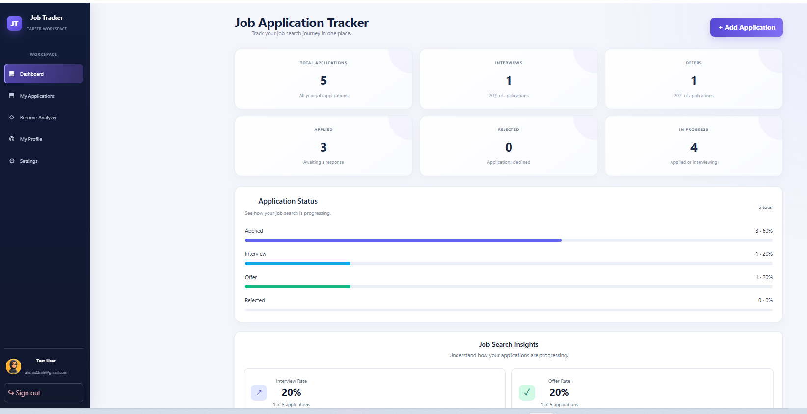
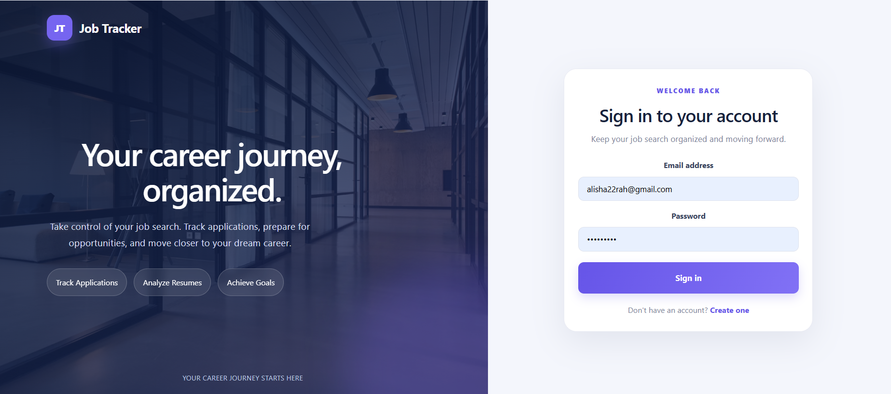
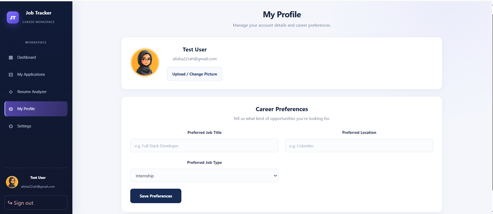
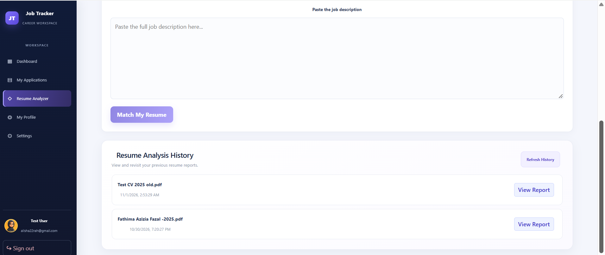
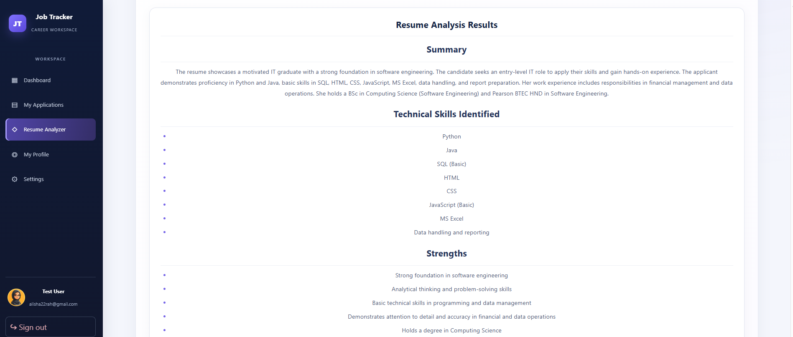
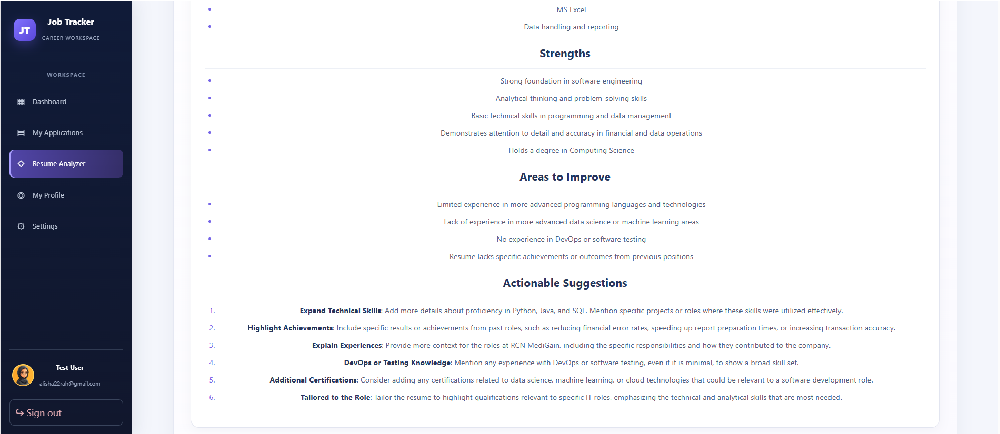
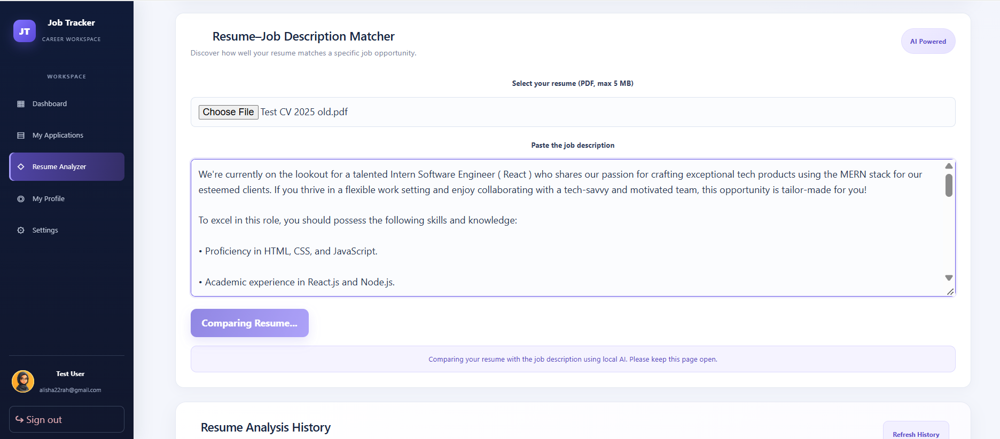
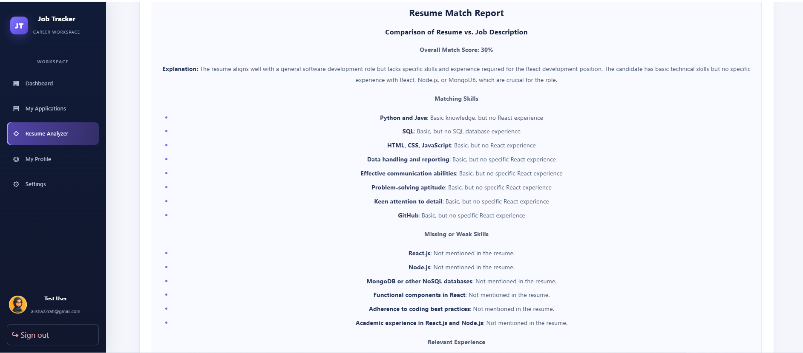
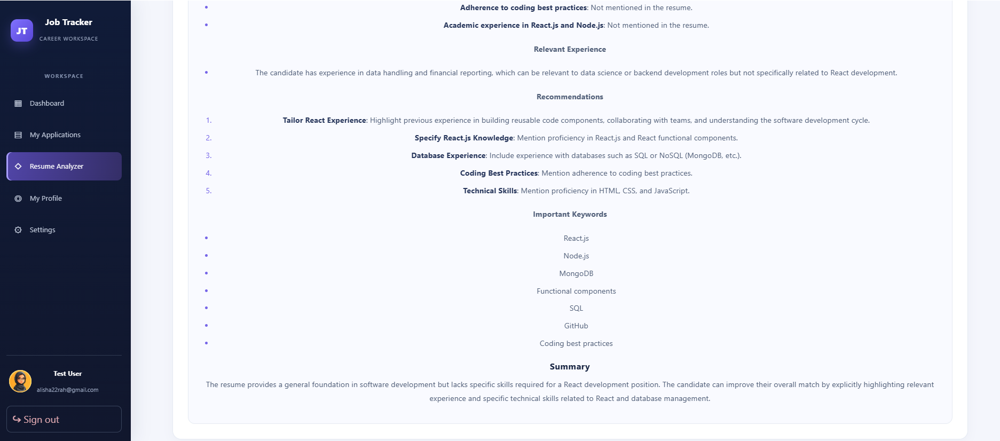
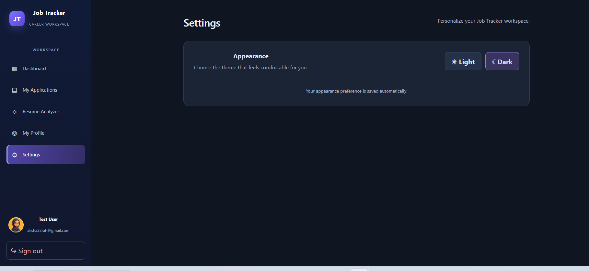

# AI Job Tracker

AI Job Tracker is a full-stack web application designed to help job seekers organize their job search, manage job applications, and improve their resumes using AI-powered tools.

## Features

### User Authentication and Profiles
- User registration and login.
- JWT-based authentication.
- Secure password hashing.
- Individual user accounts and application records.
- Profile picture upload.
- Personalized career preferences.

### Job Application Management
- Add, view, update, and delete job applications.
- Track application statuses: Applied, Interview, Offer, and Rejected.
- Search and manage applications.
- Dashboard for monitoring job application progress.

### AI-Powered Career Tools

**AI Resume Analyzer**
- Upload PDF resumes for analysis.
- Extract resume text automatically.
- Receive AI-generated feedback and improvement suggestions.
- Save and view previous analysis results.

**Resume–Job Description Matcher**
- Compare a resume with a job description.
- Identify matching skills.
- Highlight missing or less-demonstrated skills.
- Receive suggestions for improving resume relevance.

**AI Technology:** Both AI features currently use Ollama with the `qwen2.5:3b` model.

> **Important:** When running this project locally, Ollama must be installed and the `qwen2.5:3b` model must be downloaded and running to use AI features. Other job-tracking features do not require Ollama. A public deployment requires a separately hosted AI service or model; the local Ollama installation is not automatically accessible to online users.

### Additional Features
- Resume analysis history.
- Light and dark themes.
- PDF upload validation and size restrictions.

## Application Screenshots

### Dashboard


### User Login


### Profile and Career Preferences


### Resume Analysis History


### AI Resume Analysis Results




### Resume–Job Description Matcher


### Resume–Job Matching Results




### Settings


## Video Demonstration

Watch the video demonstration to see the application's main features, including job application management, AI-powered resume analysis, and resume–job description matching.


[▶ Watch the AI Job Tracker Demo on YouTube](https://youtu.be/BHEeQsFC2no)

## Technology Stack

| Component | Technology |
|---|---|
| Frontend | React, JavaScript, CSS, Vite |
| Backend | Python, FastAPI |
| Database | PostgreSQL |
| ORM | SQLAlchemy |
| Authentication | JWT |
| AI Integration | Ollama, Qwen 2.5 3B |
| Resume Processing | PDF text extraction |

## What I Learned

Developing AI Job Tracker helped me gain practical experience in full-stack application development and understand how different technologies work together.

Through this project, I gained experience with:

- Building user interfaces using React, JavaScript, and CSS.
- Developing REST APIs using Python and FastAPI.
- Connecting a frontend application to a backend API.
- Working with PostgreSQL and SQLAlchemy for database operations.
- Implementing user authentication using JWT and password hashing.
- Managing user-specific records and application data.
- Handling file uploads and extracting text from PDF documents.
- Integrating a locally hosted AI model using Ollama.
- Using AI to analyze resumes and compare resumes against job descriptions.
- Managing project dependencies and environment variables.
- Organizing and documenting a full-stack project using Git and GitHub.

This project also helped me improve my problem-solving skills by working through development issues, debugging errors, and integrating different parts of the application.

## Local Installation

### Prerequisites
- Node.js and npm
- Python
- PostgreSQL
- Ollama (for AI features)

### 1. Clone the repository

```bash
git clone https://github.com/Azi2001/AI-Job-Tracker.git
cd AI-Job-Tracker
```

### 2. Configure the backend

```powershell
cd backend
python -m venv venv
.\venv\Scripts\Activate.ps1
pip install -r requirements.txt
```

Create a `.env` file inside `backend/`, using `backend/.env.example` as a guide. Configure your PostgreSQL database URL and a secure secret key.

Start the backend:

```powershell
python -m uvicorn main:app --reload
```

The API will be available at `http://127.0.0.1:8000`.

### 3. Configure the frontend

Open another terminal in the project root:

```bash
npm install
npm run dev
```

Open the local URL displayed by Vite.

### 4. Configure Ollama for AI features

Install Ollama and download the required model:

```bash
ollama pull qwen2.5:3b
```

Ensure Ollama is running before using the Resume Analyzer or Resume–Job Description Matcher.

## Environment Variables

The backend requires:

- `DATABASE_URL`
- `SECRET_KEY`

Use `backend/.env.example` as a template. Never commit real credentials or secret keys.

## Project Status

AI Job Tracker is a portfolio project demonstrating full-stack development, database integration, user authentication, file handling, and local AI integration.

## Future Improvements

- Public deployment with persistent database and file storage.
- Hosted AI inference for users who do not have Ollama installed.
- Automated testing.
- Further improvements to resume analysis and job matching.

## Author

Developed as a Software Engineering portfolio project.